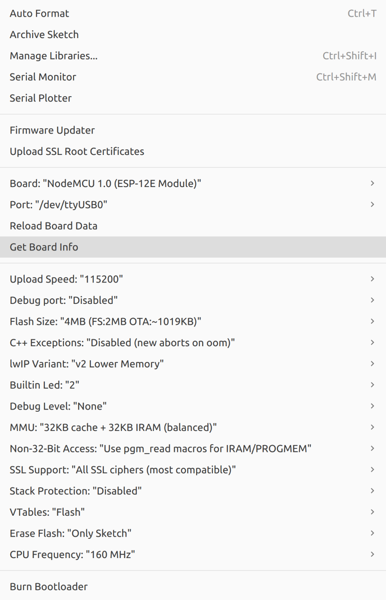

# esp32_wireless_bridge

Firmware per NodeMCU 1.0 (ESP8266 / ESP-12E): bridge WiFi per GRBL 1.1h su Arduino Uno.
Crea un access point, serve l'interfaccia web (integrata nel firmware) e gestisce
streaming G-code, jog e air cut via WebSocket.

## Cablaggio

| NodeMCU | GPIO | BSS138 LV | BSS138 HV | Arduino Uno |
|---|---|---|---|---|
| **D4** (TX, Serial1) | GPIO2 | LV1 | HV1 | **pin 0 (RX)** |
| **D7** (RX, UART0) | GPIO13 | LV2 | HV2 | **pin 1 (TX)** |
| 3V3 | — | LV | — | — |
| — | — | — | HV | 5V |
| GND | — | GND | GND | GND |

- **D8 (GPIO15) non va collegato**: deve restare basso all'avvio, altrimenti l'ESP non parte.
- Il LED blu della scheda è su D4: lampeggia durante la trasmissione verso GRBL (normale).
- Con il bridge in funzione l'USB dell'Arduino non deve essere collegata al PC (usa i pin 0/1).

## Installazione

1. Core ESP8266: in *File → Impostazioni → URL aggiuntive* aggiungi
   `https://arduino.esp8266.com/stable/package_esp8266com_index.json` e installa **esp8266**.
2. Installa le librerie e imposta la scheda come in [Riproducibilità](#riproducibilità-impostazioni-usate).
3. Carica lo sketch. Non serve caricare nulla su LittleFS: l'HTML è incorporato nel firmware.

## Connessione

Rete WiFi **CNC-Remote** (aperta, senza password) → http://192.168.4.1
(HTTP porta 80, WebSocket porta 81). SSID e canale si cambiano in `config.h`.

## Modifica UI

Dopo aver modificato `data/index.html`: `python3 tools/embed_html.py`, poi ricompila e ricarica.

## Riproducibilità (impostazioni usate)

| Software | Versione |
|---|---|
| Core **esp8266** (Arduino IDE) | 3.1.2 |
| **WebSockets** — Markus Sattler (Links2004) | 2.7.2 |
| **ArduinoJson** — Benoit Blanchon | 7.4.3 |
| LittleFS | inclusa nel core |
| Arduino Uno | GRBL 1.1h (`firmware/arduino_uno_grbl`) |

| Impostazione scheda (menu *Strumenti*) | Valore |
|---|---|
| Board | NodeMCU 1.0 (ESP-12E Module) |
| Upload Speed | 115200 |
| CPU Frequency | **160 MHz** |
| Flash Size | 4MB (FS:2MB OTA:~1019KB) |
| Debug port / Debug Level | Disabled / None |
| lwIP Variant | v2 Lower Memory |
| C++ Exceptions | Disabled (new aborts on oom) |
| MMU | 32KB cache + 32KB IRAM (balanced) |
| Non-32-Bit Access | Use pgm_read macros for IRAM/PROGMEM |
| SSL Support | All SSL ciphers (most compatible) |
| Stack Protection | Disabled |
| VTables | Flash |
| Erase Flash | Only Sketch |
| Builtin Led | 2 |



Compilazione equivalente da CLI (stesse opzioni):

```bash
arduino-cli compile --fqbn "esp8266:esp8266:nodemcuv2:xtal=160,baud=115200,eesz=4M2M,dbg=Disabled,lvl=None____,ip=lm2f,exception=disabled,mmu=3232,non32xfer=fast,ssl=all,stacksmash=disabled,vt=flash,wipe=none,led=2" firmware/esp32_wireless_bridge
```

## Funzionalità

- DRO posizione lavoro/macchina, stato GRBL, pin e override
- Jog con step preimpostati o personalizzati (tasti `[` `]`, tastierino numerico)
- Streaming G-code con flow control a conteggio caratteri, pausa automatica sugli errori
- Air cut ingombro: perimetro XY del file a quota di sicurezza, mandrino spento
- E-STOP (feed hold + reset controllato)
- Badge RAM dell'ESP (heap libero e blocco massimo)
- Viewer G-code 3D con overlay della punta
